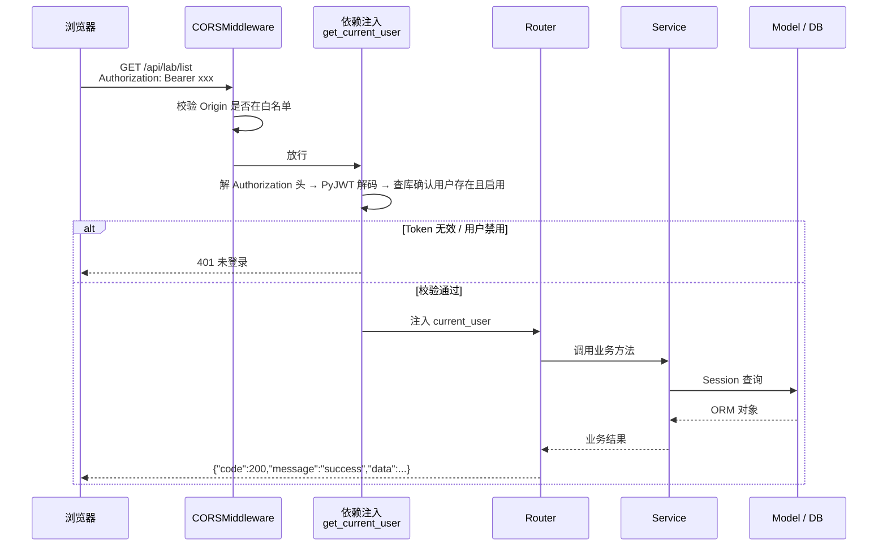
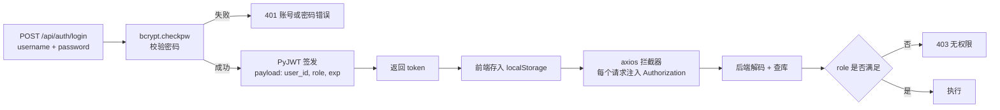
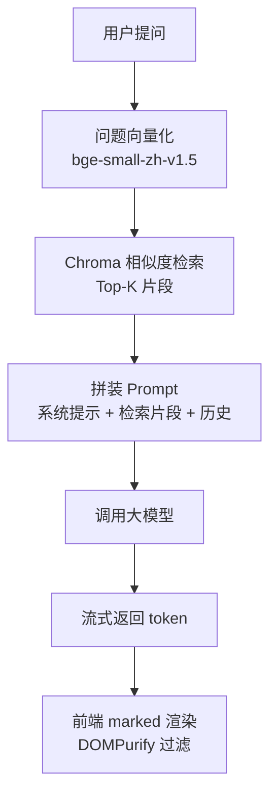
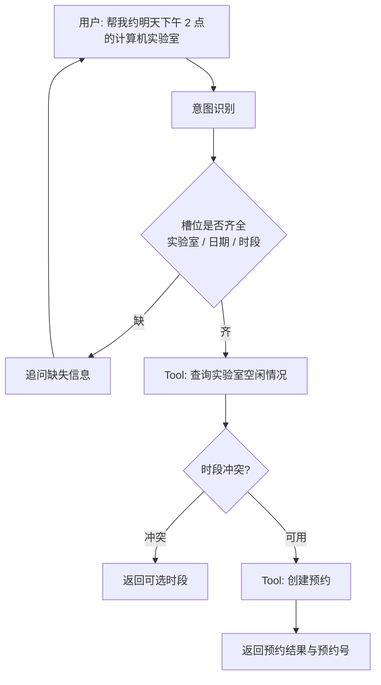

# 架构说明

本文记录系统的分层设计、关键流程与几个值得说明的实现决策。

---

## 1. 分层设计

```
Router  →  Service  →  Model  →  Database
  ↓          ↓
Schema    Utils / Common
```

| 层 | 位置 | 职责 | 不该做的事 |
| --- | --- | --- | --- |
| Router | `backend/app/api/` | 解析请求参数、注入当前用户、调用 Service、返回统一响应 | 不写业务判断、不直接操作 Session |
| Schema | `backend/app/schemas/` | 请求体与响应体的字段定义与校验 | 不承载业务逻辑 |
| Service | `backend/app/services/` | 业务规则、事务边界、跨模型编排 | 不感知 HTTP 状态码 |
| Model | `backend/app/models/` | ORM 映射与表结构 | 不写查询逻辑 |
| Common | `backend/app/common/` | 统一响应体、业务异常、全局异常处理 | — |
| Dependencies | `backend/app/dependencies/` | 当前用户解析、角色校验 | — |

这样分层的好处是：换前端（比如做成小程序）只改 Router 层；换数据库只改 `database.py` 与 Model 的方言细节；业务规则集中在 Service，单元测试可以直接对着 Service 写。

## 2. 请求生命周期



异常统一在 `main.py` 注册的四个处理器兜底：

| 异常类型 | 处理器 | 返回 |
| --- | --- | --- |
| `BusinessException` | `bussiness_excpetion_hadler` | 业务码 + 业务提示 |
| `HTTPException` | `http_excpetion_hadler` | 对应 HTTP 状态码 |
| `RequestValidationError` | `validation_excpetion_hadler` | 422 + 字段级错误 |
| `Exception` | `global_excpetion_hadler` | 500，日志记录完整堆栈 |

> 注册顺序有讲究：`Exception` 的兜底处理器必须最后注册，否则会覆盖前面更具体的处理器。

## 3. 鉴权流程



几个细节：

- **Token 里只放 `user_id` 与 `role`**，不放昵称、头像这类会变的信息，避免用户改了资料但 Token 里还是旧值。
- **每次请求都查库**（`get_current_user`），代价是一次主键查询，换来的是"禁用账号立即失效"——否则一个被禁用的用户能拿着旧 Token 用到过期。
- **前端守卫只管页面跳转，不承担安全职责**。真正的权限判断在后端依赖注入里，前端被绕过的唯一后果是自己看到一堆 403。
- **`JWT_SECRET_KEY` 更换后所有已签发 Token 立即失效**，这是设计意图：密钥泄露时唯一可靠的补救手段就是换密钥。

## 4. RAG 问答流程



知识库在 `backend/data/kb/*.md`，首次调用时自动分块、向量化并持久化到 `backend/data/chroma/`。向量模型优先读本地目录 `backend/data/models/bge-small-zh-v1.5`，不存在时才回退到 HuggingFace 下载。

**启动预热**：模型加载首次约 15 秒，放在 `lifespan` 里用 `asyncio.to_thread` 预热，避免第一个用户请求超时。预热失败只记日志、不阻断启动，因为 AI 是增强能力而不是核心链路。

## 5. Agent 流程



Agent 用 LangGraph 组织成状态机，工具函数定义在 `backend/app/services/agent_tools.py`，直接复用 Service 层，不绕过业务校验——**Agent 没有特权**，它提交的预约和用户手点提交走同一套冲突检查。

## 6. 流式输出

`POST /api/ai/chat/stream` 返回 `text/event-stream`，事件序列：

| 事件 | 含义 |
| --- | --- |
| `status` | 阶段提示（"正在检索知识库…"） |
| `tool_start` | 开始调用某个工具，携带工具名 |
| `tool_end` | 工具返回，携带结果预览 |
| `token` | 正文增量 |
| `done` | 结束，携带完整消息 |

前端用 `fetch` + `ReadableStream` 逐块解析，而不是 `EventSource`——因为需要 POST 请求体并携带 `Authorization` 头，`EventSource` 两者都做不到。

Vite 代理对 `text/event-stream` 关闭了缓冲（`x-accel-buffering: no`），否则 Nginx 或代理层会把流式响应攒成一次性返回，"逐步打字"的效果就没了。

## 7. 预约状态与过期扫描

预约状态 `status`：`0` 待审核 · `1` 已通过 · `2` 已拒绝 · `3` 已取消。

应用启动时在 `lifespan` 里拉起一个异步任务 `reservation_service.run_expire_scan()`，周期性扫描"已到时间但仍在待审核"的预约并自动置为已取消，避免幽灵预约长期占用时段。任务在应用关闭时随 `lifespan` 一起 `cancel()`。

## 8. 几个实现决策

| 决策 | 理由 |
| --- | --- |
| 用 `SessionLocal` 每请求一个会话，而非全局单例 | SQLAlchemy 的 Session 不是线程安全的，全局共享会串数据 |
| 表结构由 `Base.metadata.create_all()` 自动创建 | 演示与小规模部署不需要迁移工具；上生产建议换 Alembic |
| 密码用 bcrypt 而非 MD5/SHA | bcrypt 自带盐和可调成本因子，抗彩虹表与暴力破解 |
| 上传走扩展名白名单 + 大小限制 | 不做内容检测，但挡住 `.php` / `.exe` 这类直接可执行的类型 |
| 统一响应体 `{code, message, data}` | 前端拦截器只需判断一处 `code`，不必每个接口写一套错误处理 |
| 前端 SSE 用 `fetch` 而非 `EventSource` | 需要 POST + 自定义请求头 |
| CORS 写死白名单而非 `*` | `allow_credentials=True` 与 `*` 在规范上互斥，浏览器会直接拒绝 |
